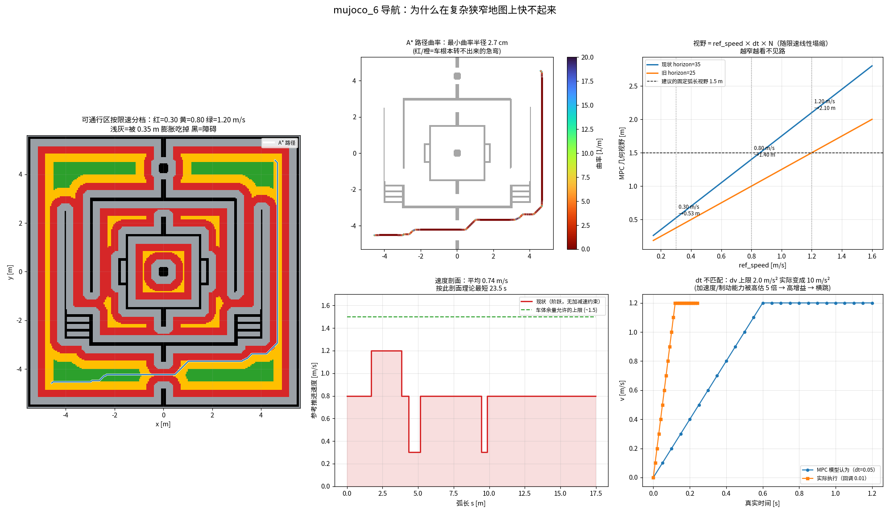

# 复杂狭窄地图上速度提不上去 —— 诊断报告

> 对象：`mujoco_6/nav`（A\* + acados MPC）
> 地图：`maps/rc2027.yaml`（224×224 @ 0.05 m，11.2 m 见方）
> 时间：2026-11-10

---

## 0. 一句话

不是「地图太窄，所以只能慢」。是**三个独立的工程问题叠在一起**，而且它们互相喂正反馈：

```
A* 路径曲率半径 2.7 cm ──┐
                        ├──> MPC 跟不准（横向误差 15 cm）──┐
命令频率 100 Hz / dt 0.05┘                                ├──> 过门会刮 ──> 把限速压到 0.3 ──┐
                                                          │                                  │
限速阈值刚好卡在路径中心 clearance 上 ─────────────────────┴──────────────────────────────────┤
                                                                                             ▼
                                                              横向偏 10 cm 就掉档 ──> 走走停停
```

换句话说：**慢是被"抖"逼出来的，而抖有三个来源，其中两个是本可以避免的 bug。**

---

## 1. 先看数据

| 项 | 值 |
|---|---|
| 典型跨场路径 (-4.6,-4.6) → (4.6,4.6) | 17.47 m，336 个栅格点 |
| 按现有速度剖面（`_build_speed_profile`）理论最短时间 | **23.4 s**，平均 **0.74 m/s** |
| `对接文档.md` 记录的实测（14 m 路径） | **38 s**，平均 **0.37 m/s**（14 m 按现有剖面应该约 19 s） |
| 可通行区（膨胀 0.35 后）占自由空间 | 58.6% |
| 路径中心 clearance 中位数 | **1.30 m** |
| 路径点中，clearance 距最近限速阈值 < 10 cm 的比例 | **71.7%** |

两个可以直接读出来的事实：

1. **实测比限速允许的还慢一倍**。23.4 s 是"全程贴着限速跑"的理想值，实际 38 s —— 说明限速不是唯一瓶颈，MPC 根本没跑到限速。
2. **限速档位卡在刀刃上**。路径中心 clearance 中位数正好 1.30 m，就是 `speed_widths` 的第一道阈值。

---

## 2. 问题 1（最硬的 bug）：`update()` 跑 100 Hz，MPC 模型却是 20 Hz

**证据链**

| 位置 | 内容 |
|---|---|
| `sim/.../mujoco_node.py:171` | `self.create_timer(0.01, self._publish_truth)` → odom **100 Hz** |
| `tests/nav_node.py` `_on_odom()` | 每收到一帧 odom 就直接 `self.nav.update(*self.pose)` → 也是 **100 Hz** |
| `nav/navigation.py:48` | `mpc_dt: float = 0.05` → MPC 模型 **20 Hz** |

**后果**

MPC 的加速度约束是 `[dv, dalpha, dw] = ±2.0`（`mpc_acados.py:215`），模型认为「一步 0.05 s 内速度变 0.1 m/s」，即 2 m/s²。
但指令每 0.01 s 就刷新一次 —— 同一个 dv 在 1/5 的时间里执行完，**等效加速度变成 10 m/s²**。

- 规划视野几何上还是 `ref_speed × 0.05 × 35 = 2.1 m`，但**时间预算只有模型的 1/5**
- 等效于把一个设计好的控制器**开环增益乘了 5** → 欠阻尼 → 左右横跳

这不是猜测：`git log` 里 `ddf7a20 fix(mpc): 直线行进时左右横跳 —— 给 α 初值加滞回` 记录的症状，和高增益振荡完全一致；后来 `ce2bd4b revert` 回滚了，因为治标不治本。

**修法（三选一，代价递增）**

```python
# ① 最省事：nav_node 里限频到 20 Hz
if self._last_nav_t + 0.05 <= time.monotonic():
    cmd = self.nav.update(*self.pose)

# ② 库内门控（推荐，库对外更鲁棒）
#    Navigation.update() 里按真实 dt 判断是否重解，中间帧沿用上一条指令

# ③ 真按 100 Hz 跑：mpc_dt=0.01, mpc_horizon=175（视野不变，代价是单帧求解变慢）
```

---

## 3. 问题 2：限速阈值按「通道宽度」定，车宽那 0.65 m 根本没扣掉

```python
# navigation.py:76
self.speed_widths = ((1.30, 0.30), (2.00, 0.80))
```

`_build_speed_profile()` 里 `clearance = 2 × dist_to_nearest_obstacle`，然后拿这个**通道宽度**去比 1.30 / 2.00。
可是车占 0.65 m，真正该比的是**余量 = 通道宽度 − 车宽**：

| 通道宽度 | 单边余量 | 现有限速 | 合理限速 |
|---|---|---|---|
| 0.90 m | 0.125 m | 0.30 | 0.30~0.40 |
| **1.30 m** | **0.325 m** | **0.30** | **1.00~1.20** |
| 1.80 m | 0.575 m | 0.80 | 1.20 |
| 2.50 m | 0.925 m | 1.20 | 1.20 |

**1.3 m 通道、单边余量 32 cm，被当成了"窄门"。** 这就是为什么这张图上 80% 的路径段都压在 0.80 档。

更糟的是**阈值和路径位置几乎重合**：

```
路径中心 clearance 中位 = 1.30 m       ← 正好是阈值
横向偏 10 cm 后 avg_vmax 0.74 → 0.40  ← 腰斩
71.7% 的路径点距最近阈值不到 10 cm
```

所以真实运行中，**车只要有一点横向误差，就自动掉进 0.30 档**；误差恢复后又跳回 0.80 档。`ref_speed` 每帧在 0.3 / 0.8 之间跳，MPC 的参考点推进速率跟着跳 —— 这就是"走走停停"的直接来源。

**修法**：改成连续函数 + 迟滞，并且用余量。

```python
margin = clearance - 0.65          # 车宽
v = np.clip((margin - 0.15) / 0.55, 0.0, 1.0) * (v_max_ref - 0.30) + 0.30
# 滞后：进入窄档用 0.15，退出窄档用 0.25，避免边界抖动
```

---

## 4. 问题 3：A\* 路径的最小曲率半径是 **2.7 cm**

```
A* 栅格原始            最小曲率半径  7.9 cm
A* + CubicSpline（现状） 最小曲率半径  2.7 cm
```

**原因**：8 邻域 A\* 只走 0°/45°/90°，一个 90° 拐角由两个 45° 折线组成；`linear.py:53` 用的是 `CubicSpline` **插值**（必须穿过每个栅格点），于是忠实复现了这个尖角。

车长 0.70 m，2.7 cm 半径的弯物理上转不出来。MPC 面对这种参考：要么"切内角"（横向偏 15 cm），要么超调。**这正是过门刮墙的来源，也是"只能 0.3 m/s"的真正原因 —— 不是门窄，是路径本身在拐角处不可跟。**

**离线验证过的修法**（拉直 + 圆弧倒角，禁止对稀疏点用插值样条）：

| 方案 | 最小曲率半径 | 路径长度 | 离障最小距离 |
|---|---|---|---|
| A\* 原始 | 0.079 m | 17.47 m | 0.55 m |
| A\* + CubicSpline（现状） | **0.027 m** | 17.50 m | 0.55 m |
| 拉直 + CubicSpline | 2.73 m（假象） | 17.99 m | **0.00 m（穿墙！）** |
| 拉直 + 圆弧 R=0.30 | 0.300 m | 16.83 m | 0.364 m |
| 拉直 + 圆弧 R=0.50 | **0.488 m** | **16.79 m** | 0.364 m |

> ⚠️ 第 3 行是个陷阱：`CubicSpline` 用在稀疏控制点上会**严重过冲**，实测最小离障距离变成 0.00 m（直接穿墙）。所以平滑必须用"圆弧/曲率受限"，不能靠插值样条。

顺带收益：路径长度 17.47 → 16.79 m（**−3.9%**）。

---

## 5. 问题 4：速度剖面和 MPC 参考轨迹是脱节的

```python
# mpc_acados.py:83
s_queries = s_start + self.ref_speed * self.dt * np.arange(self.n_horizon + 1)
```

参考点是**用单一 ref_speed 匀速推进**的。而 `ref_speed` 是 `_apply_speed_limit()` 每帧从 `_path_vmax` 查出来的**阶跃函数**，前瞻只有 0.6 m（`navigation.py:349`，注释却写着 2 m）。

结果：

- MPC 在 2.1 m 的视野里，看到的参考点**始终按当前速度匀速前进**，看不到 1.5 m 外那个 0.3 档的窄门
- 车"看不见"窄门 → 全速冲过去 → 到了门边 `ref_speed` 突然从 0.8 掉到 0.3 → 参考点瞬间"急刹" → MPC 追一个突然停住的参考点 → 抖动

**正确做法**：把 `_path_vmax` 做成分段线性的**速度场 v(s)**，参考点递推 `s_{k+1} = s_k + v(s_k)·dt`，并先做一次前后向 pass 满足加减速约束（S 形速度曲线）。这样视野内就能"看见"前方的窄门，提前 1~2 m 平滑减速。

---

## 6. 问题 5：视野随速度线性塌缩（设计上是反的）

```
视野 = ref_speed × dt × horizon

0.30 m/s → 0.53 m
0.80 m/s → 1.40 m
1.20 m/s → 2.10 m
```

**越窄越慢 → 越看不见路 → 越容易偏 → 越不敢快。** 在最需要前瞻的地方，视野最短。

应该把「视野」和「速度」解耦：视野固定 1.5~2 m 弧长，速度靠 `v(s)` 限幅。

---

## 7. 问题 6：曲率限速从来没生效过

```python
# navigation.py:82
self.lat_acc_max = 100.0        # 允许的最大横向加速度 [m/s²]
```

`v_curve = sqrt(100 / κ)`：即使 κ = 37（半径 2.7 cm），也给出 1.64 m/s —— **永远大于限速表的上限**，这一项等于没写。

`1d347ff` 的 commit 说"试过曲率限速，让过门变差 −14 cm"。原因是**路径曲率本身是噪声**（2.7 cm 半径的假弯），一加曲率限速就全程减速。

正确顺序是：**先平滑路径（问题 3），再用物理量级 `lat_acc ≈ 1.5~2.5 m/s²` 算曲率限速**。顺序反了，就会得到"曲率限速有害"的错误结论。

---

## 8. 问题 7：几个次要隐患

| 位置 | 问题 |
|---|---|
| `navigation.py:349` | 注释写"往前看 2 m"，代码是 `s_now + 0.6` |
| `navigation.py:50` | `v_max=4.0` 远大于 `ref_speed=1.2`，输出限幅形同虚设 |
| `navigation.py:83` | `speed_min=0.20` 低于限速表最低档 0.30，永不生效 |
| `navigation.py:168` | 目标落在**封闭区**（本图中心方框内）时返回 `A* 无解`，和"起点被围死"共用一条错误信息；实测中心区是"可通行孤岛"，目标选进去永远到不了 |
| `navigation.py:231` | 动态障碍开启后每次重规划 50~70 ms，发生在 100 Hz 回调里会直接卡顿 |
| `mpc_acados.py:240` | 代价里 `x[3]`（速度 v）权重是 **0** → MPC 根本没有速度闭环，速度完全由参考点推进隐式决定。所以任何"限速"都只能间接生效 |

---

## 9. 预期收益（离线可算）

同一路径，只改限速表：

| 限速表 | 理论最短 | 平均速度 | 提速 |
|---|---|---|---|
| 当前 `((1.30,0.30),(2.00,0.80))` | 23.4 s | 0.74 m/s | 1.00× |
| 温和放开 `((0.90,0.45),(1.50,1.00))` | 16.4 s | 1.06 m/s | 1.42× |
| 放开 + 提速 `((0.80,0.60),(1.40,1.20))`，wide 1.5 | 12.5 s | 1.40 m/s | **1.87×** |
| 上面 + 真实曲率限速（lat_acc 2.0） | 14.0 s | 1.25 m/s | 1.67× |

叠加路径平滑（−3.9% 长度、曲率 2.7 cm → 49 cm）后，跟踪误差应该明显下降，才敢真正把限速放开。

> 这些是**几何与剖面层面的上限**。没有 acados 环境，MPC 闭环在这台机器上跑不了，所以"实际能提到多少"必须在你容器里验证。

---

## 10. 如果只改三处

按性价比排序，全部改动量 < 60 行：

1. **对齐时间尺度**（1 行 + 门控逻辑）
   `update()` 按真实 dt 调，或 nav_node 限频 20 Hz。
   *这是唯一一条"不改任何参数就能立刻止抖"的。*

2. **限速改成「余量 + 连续 + 迟滞」**（约 20 行，`_build_speed_profile`）
   阈值减去车宽 0.65，输出连续值而不是三档阶跃。

3. **加一个路径平滑器**（约 40 行，新文件 `nav/path_smooth.py`）
   视线拉直 + 圆弧倒角，曲率下限 0.4 m，逐段检查不侵入膨胀区。

做完 1+2+3 再考虑：
4. 速度场 v(s) 前后向 pass（让 MPC 提前看见窄门）
5. 视野解耦（固定弧长）
6. 给 MPC 加 v 的参考权重（现在权重是 0，没有速度闭环）

---

## 11. 怎么验证

```python
# ① 抖没抖：记录每帧 ref_speed，数跳档次数
#    改之前大概率每几帧就在 0.30/0.80 之间跳一次
log_ref.append(nav.mpc.ref_speed)

# ② 路径质量：算最小曲率半径
#    现在应该是 0.027 m 左右，改完应该 > 0.4 m

# ③ 跟踪误差：/plan 与 /odom 的横向偏差
#    README 说 15 cm，这就是过门刮墙的根源

# ④ 时间：从 set_goal 到 phase=='ARRIVED' 的墙钟时间
```

诊断脚本已放在 `_diag/`（`path_quality.py`、`sweep_width.py`、`plot_diag.py`），
`PYTHONPATH=/home/yemu/my_work/.pylibs python3 plot_diag.py` 可重出下面这张图。

---

## 附：诊断图



- **左**：可通行区按限速分档。红色（0.30 档）占满通道两侧，绿色（1.20 档）只剩几个角落 —— 路径实际走的黄色带很窄，两侧紧贴红色。
- **中上**：A\* 路径曲率，最小半径 2.7 cm，全部集中在 90° 拐角。
- **中下**：速度剖面是阶跃的，没有任何加减速过渡。
- **右上**：视野随 ref_speed 线性塌缩。
- **右下**：dt 不匹配导致加速度能力被高估 5 倍。
